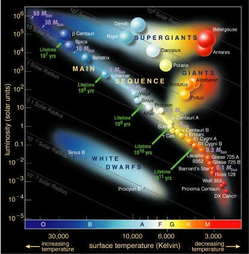

# Stellar Structure and Evolution

Stellar interiors cannot be observed directly

Certain properties of stars do not vary independantly over their full range: mass, luminosity, radius, and effective temperature are all linked to a physical principle that does not allow them to have randomness. A high mass star must have a hot core.

There are two main relationships:

- Luminosity vs temperature on a Hertzsprung Russel Diagram
- Mass-Luminosity diagram



Studying clusters provides information related to the age of the stars within it as they formed at roughly the same time and have similar compositions. What does differ is the mass that they accumulate.

The mass luminosity relation allows us to find accurate star masses from its observed brightness. For a small proportion of MS stars, this holds true. $L_{S} \approx M^{4}_{s}$

```math
L = 4 \pi r^{2} \sigma_{SB} T_{eff}^{4}
```

## Equations of Stellar Structure

Initial Assumptions:

- Basic physics applies
- Time can be neglected initially
- Stars are spherically symmetric

Distance from the centre of the star $r$

Key Areas:

- Structure
  - Gravitational attraction vs internal pressure gradient from thermal motion
  - Two forces must be in balance
- Thermal
  - Continual radiation of energy balanced by energy production
  - Origin of energy
  - Transport of energy to surface
- Fusion
  - Changes in stellar composition

If we approximate stars as static systems then we need to consider to how the properties evolve with its characteristic timescale

## Hydrostatic Support

Balance forces from pressure away from centre and to centre of mass element

```math
P(r) \delta s = P(r+\delta r) \delta s + \frac{GM}{r^{2}} \rho\, \delta s \delta r
```

Divide $\delta s$

```math
P(r) = P(r+\delta r) + \frac{GM}{r^{2}} \rho \, \delta r
```

Rearrange

```math
P(r+\delta r) - P(r) = -\frac{GM}{r^{2}} \rho \, \delta r 
```

$P(r+\delta r) - P(r)$ becomes $dP$

```math
\frac{dP}{dr} = -\frac{GM(r)}{r^{2}} \rho (r)
```

## Mass Conservation

Consider volume of a shell of mass

```math
V = 4 \pi r^{2} \delta r \rho(r)
```

Rewrite as $M(r + \delta r) - M(r)$

```math
V = M(r + \delta r) - M(r) = \frac{dM}{dr} \delta r
```

```math
\frac{dM}{dr} \delta r = 4 \pi r^{2} \delta r \rho(r)
```

Remove $\delta r$

```math
\frac{dM}{dr} = 4 \pi r^{2} \rho(r)
```

## Timescales

Stars do vary in size over long timescales by which forces may not be balanced and there may be a resultant force $F = \rho (r) \, \delta s \, \delta r \, a$.

Assume that the freefall of a test particle is $t = \frac{1}{\beta^{\frac{1}{2}}} \left( \frac{2r^{3}}{GM}\right)^{\frac{1}{2}}$, it is used to determine a star's dynamical timescale.

```math
t_{D} = \left( \frac{2r^{3}}{GM}\right)^{\frac{1}{2}}
```

Generally, characteristic timescales are defined as the ratio of a quantity that is changed to the rate of change of its own quantity

```math
\tau = \frac{\phi}{\dot \phi}
```

### Other Timescales

Timescales include:

- Thermal timescale (Kelvin-Helmholtz)
  - Characteristic ROCO thermal energy $t_{th} = \frac{U}{L}$
- Nuclear timescale, $t_{nuc}$
  - Total nuclear energy resources of rate of energy loss

## Minimum Central Pressure

Combine both the hydrostatic equation with the mass conservation equation to find a function relating pressure to mass

Using the assumptions:

- at $r = R, \, P = 0, \, M = M_{*}$
- at $r = 0, \, P = P_{C}, \, M = 0$

```math
dM = -4 \pi r^{2} \rho (r) \cdot \frac{r^{2}}{GM\rho (r)} dP
```

```math
-\int_{0}^{M_{S}} \frac{GM}{4\pi r^{4}} = \int_{P_{C}}^{P_{S}=0} dP
```

```math
-\frac{G}{4\pi r^{4}} \left[\frac{M_{S}^{2}}{2}\right] = -\frac{GM_{S}^{2}}{8\pi r^{4}} = P_{S} - P_{C} 
```

$r(M)$ will always be less than $R_{S}$ and $P_{S} = 0$

```math
P_{C} > \frac{GM_{S}^{2}}{8\pi R_{s}^{4}} 
```

## Virial Theorem

Relates the potential and kinetic energies of a system of particles in equilibrium. Started by equating the equations of hydrostatic support and mass conservation.

```math
\frac{dP}{dr} \cdot \frac{4}{3} \pi r^{3} = -\frac{GM(r)}{r^{2}} \rho (r) \cdot \frac{4}{3} \pi r^{3} 
```

Substitute the equation of mass conservation:

```math
\frac{dP}{dr} \cdot \frac{4}{3} \pi r^{3} = -\frac{GM(r)}{3r}\cdot \frac{dM}{dr} 
```

Cancel $dr$ by multiplication and separate variables

```math
3 \int_{P_{C}}^{P_{S}} \frac{4}{3} \pi r^{3} dP = - \int_{0}^{M_{S}} \frac{GM(r)}{r}\cdot dM 
```

Use volume and integrate by parts, realise that at core pressure is big but has no volume and at surface volume is big but has no pressure

```math
3[PV]_{C}^{S} - 3 \int_{0}^{V_{s}} P dV \approx - 3 \int_{0}^{V_{s}} P dV
```

Work done is $W = Fs$ where $F=ma$, so the gpe for small element $\Omega$ is

```math
d\Omega = \int_{\infty}^{r} dM \frac{GM}{r^{2}} dr = -\frac{GM}{r} dM
```

Integrate for full $\Omega$

```math
\Omega = - \int_{0}^{M_{s}} \frac{GM}{r} dM
```

Put LHS and RHS together

```math
\Omega + 3 \int_{0}^{V_{S}} P dV = 0
```

## Minimum Average Temperature

Take the Virial theorem equation and the equation for gravitational potential energy and consider that $r<R_{S}, \, \frac{1}{r} > \frac{1}{R_{S}}$ as well as $- \Omega > \int_{0}^{M_{S}} \frac{GM}{r}dM$

If $\rho = \frac{dM}{dV}$

```math
3 \int_{0}^{M_{S}} \frac{P}{\rho} dM = - \Omega
```

If $P = nkT = \frac{\rho kT}{m_{H}}$

```math
\frac{3k}{m_{H}} \int_{0}^{M_{S}} T dM > \int_{0}^{M_{S}} \frac{GM}{R_{S}}dM
```

Consider that $\int_{0}^{M_{S}} T dM = M_{S}T_{av}$

```math
M_{S}T_{av} > \frac{m}{3k} \int_{0}^{M_{S}} \frac{GM_{S}}{R_{S}}dM
```

```math
T_{av} > \frac{GM_{S}m}{6kR_{S}}
```

### State Stellar Material

Mean stellar density can be estimated as

```math
\rho_{av} = \frac{3M_{\odot}}{4 \pi R_{S}^{3}}
```

Plasma is a highly ionized gas that fills has a comparible density to an ordinary liquid but at a high temperature.

## The Sun

The Sun has 4 possible sources of energy: Cooling, Contraction, Chemical reactions, and Nuclear reactions.

### Cooling/ Contraction

```math
2U + \Omega = 0
```

#### On the Thermal Timescale

```math
E_{tot} = U + \Omega = -U = \frac{\Omega}{2}
```

```math
t_{th} = \frac{\Omega}{L_{S}} = \frac{GM_{S}^{2}}{L_{S}T_{S}}
```

### Chemical

Chemical reactions typically release ~$5 \times 10^{-10}$ of the rest mass energy of the constituents

### Nuclear

- Fission release ~$5\ times 10^{-4}$ of the rest mass energy
- Fussion release ~$10^{-2}$ of the rest mass energy

The Sun uses predominantly fussion by converting 4 H atoms to 1 He atom, the 0.7% mass difference is what becomes released energy

## Equation of Energy Production

The energy generation per unit mass is $\epsilon = \frac{E}{M\cdot t}$

```math
V = 4 \pi r^{2} dr
```

```math
dM = 4 \pi r^{2} \rho(r) dr
```

```math
L_{r+dr} - L_{r} = dL = 4 \pi r^{2} \rho(r) \epsilon \, dr
```

```math
\frac{dL}{dr} = 4 \pi r^{2} \rho(r) \epsilon
```

## Equations of State

We need a relation between Pressure as a function of density, temperature and the composition of the star, this type of equation is named an equation of state

Stars are made of plasmas that have a typical density of $1.5 \times 10^{5} \mathrm{kgm^{-3}}$ with an inter-particle separation of $2.2 \times 10^{-11} \mathrm{m}$. A cubic volume of $0.5\AA$ will contain around 11 protons

Taking the ideal gas equation:

```math
P_{gas} = nkT
```

```math
\rho = nm = nm_{H}\mu
```

where $n$ is number of particles per unit volume and $m$ is the mean particle mass, $m_{H}$ is the mass of a hydrogen atom, and $\mu$ is the mean molecular weight of the stellar material

```math
P_{gas} = \frac{kT\rho}{m} = \frac{kT\rho}{m_{H}\mu} = \frac{RT\rho}{\mu}
```

Where $R = \frac{k}{m_{H}}$

Radiation pressure may not be negligible in stars so the summed pressure is

```math
P = P_{gas} + P_{rad} = \frac{RT\rho}{\mu} + \frac{aT^{4}}{3}
```

Where $a$ is the radiation density constant

$\mu$ is not constant and depends on the fractional ionisation of all elements in all parts of a star, we assume that H and He are the most abundant than all other elements and are fully ionised in stellar interiors though this assumption does not hold true closer to the stellar surface

Also assume:

- $X$: the fraction of the mass in H
- $Y$: the fraction of the mass in He
- $Z$: the fraction of the mass in all other metals
- $X+Y+Z=1 \quad \implies \quad X\rho + Y\rho + Z\rho = 1 \rho$

When a particle is fully ionised, its atom is stripped of all of its electrons, leaving individual electrons and a nucleus, measured in $m_{H}$

This leads to:

- H - $n_{H} = \frac{X\rho}{m_{H}/2}$
- He - $n_{He} = \frac{Y\rho}{4m_{H}/3}$
- Metals - $n_{Z} = \frac{Z\rho}{2m_{H}}$

```math
n = n_{H} + n_{He} + n_{Z} = \frac{\rho}{4m_{H}}(8X + 3Y + 2Z)
```

Use $X+Y+Z = 1$ to remove $Z$

```math
\frac{\rho}{4m_{H}}(8X + 3Y + 2(1 - X -Y)) =\frac{\rho}{4m_{H}}(6X + Y + 2)
```

Use $\rho = nm_{H}\mu$

```math
\mu = \frac{4}{6X+Y+2}
```

This is a good approximation for $\mu$ when close to the centre
