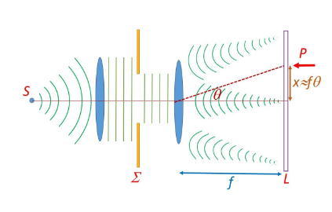

# Fourier Techniques and Optics

## Fourier Series

Fourier series are applied to situations where we have a continuously repeating, periodic function of time or distance

Any periodic function can be described by a Fourier series consisting of an infinite number of sine and/or cosine terms of frequencies equal to the fundamental frequency of the original function plus its harmonics

If $f(t)$ is periodic then use a Fourier series and if $f(t)$ is non-periodic then use a Fourier transform

The frequency components will be $nf_{0}$ where $n=1,2,3...\infty$, it tells us how much of each frequency is present

Consider a sine wave, it is easy to write in the form of a differential equation i.e., $m \frac{d^{2}x}{dt^2} + \gamma \frac{dx}{dt} + kx = Asin(\omega t)$. For a square wave, this is much more difficult and requires a Fourier series representation i.e., $m \frac{d^{2}x}{dt^2} + \gamma \frac{dx}{dt} + kx = A'\sum^{\infty}_{n=1(odd)} \frac{1}{n}sin(n\omega t)$

If $f(t)$ is a periodic function of period T then the Fourier series for $f(t)$ is:

```math
f(t) = \frac{1}{2}a_{0} + \sum^{\infty}_{n=1} \left(a_{n}cos\frac{2n\pi t}{T} + b_{n}sin\frac{2n\pi t}{T}\right) \quad n=1,2,3...\infty
```

Where:

```math
a_{0} = \frac{2}{T} \int_{0}^{T} f(t)dt \qquad a_{n} = \frac{2}{T}\int_{0}^{T}f(t)cos\frac{2n\pi t}{T}dt \qquad b_{n} = \frac{2}{T}\int_{0}^{T}f(t)sin\frac{2n\pi t}{T}dt
```

> These can be written similarly for $f(x)$ of period $L$, any limit evaluated for an integral over one period is valid.

If $T=2\pi$ then:

```math
f(t) = \frac{1}{2}a_{0} + \sum^{\infty}_{n=1} \left(a_{n}cos \, nt  + b_{n}sin \, nt \right) \quad n=1,2,3...\infty
```

Where:

```math
a_{0} = \frac{1}{\pi} \int_{0}^{2\pi} f(t)dt \qquad a_{n} = \frac{1}{\pi}\int_{0}^{2\pi}f(t)cos \, nt \, dt \qquad b_{n} = \frac{1}{\pi}\int_{0}^{2\pi}f(t)sin \, nt \, dt
```

$\frac{a_{0}}{2}$ is sthe average of $f(t)$ over one period.

> Equations are given in the exam

### Series Symmetry

> Symmetry and Parity refer to the same idea

Many functions have even or odd symmetry (some have neither). All terms in a Fourier series must have same symmetry as the original function. For example, if $f(x)$ is an even function then there will only be terms with $cos(nx). Alternatively, if $f(x)$ is odd then only $sin(nx)$ will be present

> A constant has even symmetry, this is why we only have $a_{0}$

The product of $f(x)$ and its trig function will likely result in an even function which can be used to simplify the integral they are under:

```math
\frac{2}{L}\int^{\frac{L}{2}}_{\frac{-L}{2}} (even \, function)dx = 2 \times \frac{2}{L}\int^{\frac{L}{2}}_{0} (even \, function)dx
```

> Do not confuse the lower bound of the summation to indicate the symmetry of the function

### Half Range Series

Some functions may have a limited range over say, $0 \rightarrow L$, we can use the Fourier series by assuming that this range is repeating with periodicity $L$

> If a repeating function is neither odd or even then assume that there will be both cosine and sine terms

We can make it easier by forcing the periodicy to be $2L$ allowing forced symmetry

### Frequency Spectra

The values of $a_{n}$ and $b_{n}$ tell us which frequency components are present in the function and their amplitudes.

A square wave has frequency components $f_{0}, \, 2f_{0} \, 3f_{0} \, 4f_{0} \, 5f_{0}...$ with relative amplitudes 1:0:1/3:0:1/5...

This can be plotted on a graph of $F(f)$ against $f$

## Fourier Transforms

As $T \rightarrow \infty$ the fundamental frequency $1/T \rightarrow 0$ and the harmonics get closer together, eventually it will be replaced with a continuous distribution of frequencies with the discrete summations replaced with an integral

```math
F(\omega) = \frac{1}{\sqrt{2\pi}} \int^{\infty}_{-\infty} f(t)e^{-i\omega t}dt \quad \mathrm{where} \quad  f(t) = \frac{1}{\sqrt{2\pi}} \int^{\infty}_{-\infty} F(\omega)e^{i\omega t}d\omega
```

```math
F(k) = \frac{1}{\sqrt{2\pi}} \int^{\infty}_{-\infty} f(x)e^{-ikx}dx \quad \mathrm{where} \quad f(x) = \frac{1}{\sqrt{2\pi}} \int^{\infty}_{-\infty} F(k)e^{ikx}dk
```

> $e^{i \theta} = cos \theta + i sin \theta$, $k = \frac{2\pi}{\lambda}$, $\omega = \frac{2\pi}{T}$, use $\omega$ rather than $f$ for posterity
>
> Equations are given in the exam

### Sinc Function

The Sinc function is defined as:

```math
sinc(x) = \frac{sin(x)}{x}
```

It spans between $\omega = \pm \infty$ but most of the intensity is between the first two zero points either side of $\omega = 0$. This means that the width of $F(\omega)$ is between the first two zeros.

The products of the widths of $f(t)$ and $F(\omega)$ are inversely proportional to each other and so, equal to a constant

### Transform Symmetry

```math
F(k) = \frac{1}{\sqrt{2\pi}} \int^{\infty}_{-\infty} f(x)e^{-ikx}dx = \frac{1}{\sqrt{2\pi}} \int^{\infty}_{-\infty} f(x)cos(kx)dx - \frac{i}{\sqrt{2\pi}} \int^{\infty}_{-\infty} f(x)sin(kx)dx
```

> This is also from $e^{i \theta} = cos \theta + i sin \theta$

If $f(x)$ is even then only the first integral is non-zero and $F(k)$ will be $\textbf{real}$, if $f(x)$ is odd then only the second integral is non-zero and $F(k)$ will be $\textbf{complex}$

If $f(x)$ is real and even then:

```math
F(k)=\frac{1}{\sqrt{2\pi}} \int^{\infty}_{-\infty} f(x) cos(kd) dx = \frac{2}{\sqrt{2\pi}} \int^{\infty}_{0} f(x) cos(kd) dx
```

### Dirac Delta Function

Consider a rectangular pulse of area 1 unit, we decrease the width until the height $\rightarrow \infty$ and width $\rightarrow 0$. This is the delta function $\delta (x)$. Total integral is still 1.

```math
\int_{-\infty}^{\infty} \delta (x) dx = 1 \quad \text{centred at} \, x=0
```

```math
\int_{-\infty}^{\infty} \delta (x-x_{0}) dx = 1 \quad \text{centred at} \, x=x_{0}
```

The product of the delta function with any function $f(x)$ is zero for all $x$ except where $x=x_{0}$

```math
\int_{-\infty}^{\infty} f(x) \delta (x-x_{0}) dx = f(x_{0})
```

## Convolution

Convolution is a mathematical process which takes 2 input functions $f(x)$ and $g(x)$ and produces an output function.

> $f(x)$ is the responce of a measurement system and g(x) is the quantity being measured. The convolution gives what we actually measure, it tells us how the properties of our measurement system distort the quantity being measured.

A real detector would have a non-zero width but an ideal detector would have negligible thickness which distorts the measured profile

This is a problem because it could hide fine detail if present in the aperture

Often we see the measurement system has a Gaussian response and a single sharp feauture will give significant broadening, obscurring the output

### Convolution Definition

$f(x)$ is the system response function, $g(x)$ is the signal function

Introduce dummy variable $u$, enters as $f(u)$ and $g(x-u)$. Replot where $x$ is now a constant and the functions are offset by an amount $x$

For a given $x$, calculate the overlap between the two functions of $u$. Done by keeping $x$ constant and integrating the product of the two functions between $-\infty \rightarrow +\infty$ with respect to $u$

This gives a new function $c(x)$ which is the detected signal as a function of $x$. It is the convolution of the functions $f(x)$ and $g(x)$

```math
c(x) = f \ast g = \int^{\infty}_{-\infty} f(u)g(x-u)du
```

> Generally only performed using a computer

### Convolution with Delta Function

```math
c(x)=f \ast g = \int^{\infty}_{-\infty} \delta (u)g(x-u)du
```

```math
= \int^{\infty}_{-\infty} \delta (u)g(x)du = g(x)\int^{\infty}_{-\infty} \delta (u)du = g(x)
```

```math
g(x) = g(x) \ast \delta (x)
```

### Convolution Theorem and Deconvolution

If $C(k)$ is the Fourier transform of the convoluted function then:

```math
C(k) = \sqrt{2\pi} F(k)G(k)
```

To find $f(x)$

```math
F(k) =\frac{C(k)}{G(k)\sqrt{2\pi}} \qquad f(x) = \frac{1}{2\pi} \int^{\infty}_{-\infty} e^{ikx} \frac{C(k)}{G(k)}dk
```

The convolution of two Gaussian characterised by $a$ and $b$ is also a Gaussian characterissed by $\Delta$

The value of $\Delta$ is dominated by whichever is the smaller of $a$ or $b$, and is always ssmaller then either of them. The convolution of two Gaussians is always wider than either of the two startig functions

## Diffraction

The propagation of light described by a wave vector or wave number $k = 2\pi / \lambda$. Before the diffraction apperture, the light only moves in one direction, but after, it can move in two dimensions.

Light from a point source $S$ spreads out and hits screen $\Sigma$ which contains an aperture, it is diffracted and the light spreads to form a diffraction pattern on second screen $L$. We are trying to find the intensity of light hitting screen $L$ as a function of distance from the central line.

If waves incident on and leaving the aperture can be considered to be plane then we have Fraunhofer diffraction but if they are not plane, then they are considered Fresnel Diffracted (not considered here).

Can achieve Fraunhofer diffraction with:

1. Large distances between $S$ and $\Sigma$
2. Large distances between $\Sigma$ and $L$
3. Use two lenses to produce incoming and outgoing plane waves (produced by focal plane of second lens at a distance $f$ from $\Sigma$)

If $f(x)$ describes the transmission of light through the aperture in screen $\Sigma$ then Fraunhofer diffraction pattern produced on screen $L$ is given by $|F(k_{x})|^{2}$ where $F(k_{x})$ is:

```math
F(k_{x}) = \frac{1}{\sqrt{2 \pi}} \int^{\infty}_{-\infty} f(x) e^{-ik_{x}x}dx
```

```math
k_{x} = \frac{2 \pi \text{sin}\theta}{\lambda}
```

```math
|\bold{k}| = \frac{2\pi}{\lambda}
```

And for small angles:

```math
\text{sin} \theta \approx \text{tan} \theta \approx \theta \approx \frac{x}{f} \; \text{or} \; \frac{x}{s}
```



$f$ is the distance to screen $L$ when a lens of focal length $f$ is used to create the diffraction pattern and $s$ is the separation between screens $\Sigma$ and $L$ when a lens is not in use.

### Cheatsheet

1. Write down function $f(x)$ that describes the transmission of light through the screen - the aperture function
2. Calculate the Fourier Transform of $f(x)$ to give $F(k_{x})$
3. Calculate $|F(k_{x})|^{2}$
4. Substitute in for $k_{x} = \frac{2 \pi \text{sin}\theta}{\lambda}$
5. Replace $\text{sin}\theta with x/f or s/f$

### Fraunhofer Example

Consider diffraction by a long slit of width $w = 2a$, $f(x)$ is a top-hat function of the same width equal to $0$ where the screen does not transmit light and $1$ where it does.

```math
F(k_{x}) = \frac{2a}{\sqrt{2 \pi}} \frac{\text{sin}(k_{x}a)}{k_{x}a}
```

```math
|F(k_{x})|^{2} = \left(\frac{2a}{\sqrt{2 \pi}}\right)^{2} \left(\frac{\text{sin}(k_{x}a)}{k_{x}a}\right)^{2}
```

Prefactor is not important and can just be subbed as $I_{0}$ which gives the overall intensity of the diffraction

Use:

```math
k_{x} = \frac{2 \pi \text{sin}\theta}{\lambda} \approx \frac{2 \pi \theta}{\lambda}
```

```math
I(\theta) = I_{0}\left(\frac{\text{sin}(2 \pi a\theta)/ \lambda}{(2 \pi a\theta)/ \lambda}\right)^{2} = I_{0} \text{sinc}^{2}\left(\frac{2 \pi a\theta}{\lambda}\right)
```

If $\theta \approx x/s$

```math
I(\theta) = I_{0}\left(\frac{\text{sin}(2 \pi ax)/ s \lambda}{(2 \pi ax)/s \lambda}\right)^{2} = I_{0} \text{sinc}^{2}\left(\frac{2 \pi ax}{s\lambda}\right)
```

With width of slit $w = 2a$

```math
I(\theta) = I_{0} \text{sinc}^{2}\left(\frac{\pi w x}{s\lambda}\right)
```

The first zeros occur when argument of sinc is $\pm \pi$:

```math
\frac{\pi w x}{s\lambda} = \pm \pi \qquad \rightarrow \qquad x = \pm \frac{s\lambda}{w}
```

This means that the width of the central maxima is given by:

```math
\Delta x = \frac{2s\lambda}{w}
```

> Consistent with the inverse relationship between widths of slit $f(x)$ and width of diffraction pattern $|F(k_{x})|^{2}$ as expected from knowledge of fourier transforms
>
> Triangular slit creates a wider central maxima but weaker subsidiary maxima
>
> The values of $f(x)$ can be complicated, not just 1 or 0
>
> Only get significant diffraction is the size of the aperture is comparable to or smaller than the wavelength, if the aperture size is significantly greater then there will be no diffraction

### 2D

In two dimensions consider using this general fourier transform

```math
F(k_{x}, k_{y}) = \frac{1}{\sqrt{2 \pi}}\frac{1}{\sqrt{2 \pi}} \int^{\infty}_{-\infty}\int^{\infty}_{-\infty} f(x,y) e^{-ik_{x}x}e^{-ik_{y}y} dxdy
```

#### Rectangular Aperture

You can split this general form for a rectangle aperture $f(x,y) = g(x),h(y)$ where $g(x), h(y)$ are both top-hat functions of widths $2a$, $2b$:

```math
F(k_{x}, k_{y}) = \frac{1}{\sqrt{2 \pi}} \int^{\infty}_{-\infty} g(x) e^{-ik_{x}x} dx \frac{1}{\sqrt{2 \pi}} \int^{\infty}_{-\infty} h(y) e^{-ik_{y}y} dy
```

```math
I(x,y) = I_{0}\left(\frac{\text{sin}(2 \pi ax)/ s \lambda}{(2 \pi ax)/s \lambda}\right)^{2} \left(\frac{\text{sin}(2 \pi by)/ s \lambda}{(2 \pi by)/s \lambda}\right)^{2}
```

```math
I(x,y) = I_{0} \text{sinc}^{2}\left(\frac{2 \pi ax}{s\lambda}\right)\text{sinc}^{2}\left(\frac{2 \pi by}{s\lambda}\right)
```

This leads to a diffrawction pattern in 2D with conical/ circular rings of intensity

> X-ray diffraction is usesd for crystallography to find the Fourier transforms of crystal structures, DNA and proteins can also be determined using this

#### Circular Aperture

> This is most important for telescopes as it's what determines the ability to resolve stars

Unlike the rectangular aperture, the circular aperture cannot be split up so the general solution remains

```math
F(k_{x}, k_{y}) = \frac{1}{\sqrt{2 \pi}}\frac{1}{\sqrt{2 \pi}} \int^{\infty}_{-\infty}\int^{\infty}_{-\infty} f(x,y) e^{-ik_{x}x}e^{-ik_{y}y} dxdy
```

Instead, diffraction depends on a first order Bessel function $J_{1}()$ which has no easy analytical expression and so tables or a computer must be used for it to be viable. $D$ is the diameter of the aperture.

```math
I(\theta) = I_{0} \left( \frac{2J_{1}(\pi D \text{sin}\theta / \lambda)}{\pi D \text{sin}\theta / \lambda} \right)^{2}
```

Diffraction for a circular aperture has a similar form to a thin slit, the first zeros of Bessel function occur for arguments $\approx \pm 1.22 \pi$ and the first zeros of sinc function occur at $\pm \pi$:

```math
\pi D \text{sin} \theta /\lambda \approx \pm 1.22\pi \qquad \text{sin}\theta \approx \theta = \pm \frac{1.22\lambda}{D}
```

```math
\Delta \theta \approx 2.44 \frac{\lambda}{D} \qquad \Delta x \approx 2.44 \frac{\lambda s}{D}
```

### 2 Very Narrow Slits

If slits have separation $d$ then you can model them with two Dirac delta functions at $x= \pm d/2$

```math
f(x) = \delta(x+d/2) + \delta(x-d/2)
```

f(x) is an even function so we can use the cosine approach to find the Fourier transfomr

```math
F(k_{x}) = \frac{2}{\sqrt{2\pi}} \text{cos}(k_{x}x)dx = \frac{2}{\sqrt{2\pi}} \text{cos}\left(\frac{k_{x}d}{2}\right)
```

With approximation:

```math
k_{x} \approx \frac{2 \pi \theta}{\lambda} \approx \frac{2\pi x}{\lambda f}
```

```math
I(x) = I_{0} \text{cos}^{2} \left(\frac{2 \pi x}{\lambda f} \frac{d}{2}\right) = I_{0} \text{cos}^{2} \left(\frac{\pi x d}{\lambda f}\right)
```

This leads to periodic bright and dark fringe regions. First fringe is at $x=0$ are the following ones are when the argument of the diffraction equation equals $\pm \pi$

```math
\frac{\pi d}{\lambda f} x = \pm \pi \qquad \rightarrow \qquad x = \pm \frac{\lambda f}{d}
```

Fringe spacing is:

```math
\Delta x = \frac{\lambda f}{d}
```

### 2 Slits Non-Zero Width

Consider two slits each of width $w$ and with a centre-to-centre seperation $d$. You can describe this system using the convolution of two delta functions at $\pm d/2$ as $g(x)$ and a top-hat function of width $w$ as $h(x)$. The transmission functrion describing the aperture is then $f(x) = g(x)*h(x)$

Using the convolution theory

```math
F(k_{x}) = \sqrt{2\pi} G(k_{x}) H(k_{x})
```

```math
G(k_{x}) = \frac{2}{\sqrt{2\pi}} \text{cos}\left(\frac{k_{x}d}{2}\right) \qquad H(k_{x}) = \frac{2(w/2)}{\sqrt{2 \pi}}\frac{\text{sin}(k_{x}w/2)}{(k_{x}w/2)}
```

```math
F(k_{x}) = \frac{2w}{\sqrt{2 \pi}} \text{cos}\left(\frac{k_{x}d}{2}\right) \frac{\text{sin}(k_{x}w/2)}{(k_{x}w/2)}
```

Square and sub in $k_{x}$ and $I_{0}$ prefactor:

> ```math
> k_{x} \approx \frac{2\pi x}{f \lambda}
> ```

```math
I(x) = I_{0} \text{sinc}^{2} \left( \frac{\pi w}{f \lambda} x \right) \text{cos}^{2} \left( \frac{\pi d}{f \lambda} x \right)
```

The sinc term refers to diffraction by a single slit and the cos term is the diffraction interference by two bery narrow slits

> Sinc term is periodically equal to zero so some of the fringes are missing - known as missing orders

### Array of N Identical Slits

Aperture function $f(x)$ consists of $N$ top-hat functions each of width $w$ with centre-to-centre separation $d$. By taking the convolustion of a single top-hat function $h(x)$ of width $w$ and a function $g(x)$ consisting of $N$ delta functions of separation $d$:

```math
g(x) = \delta (x) + \delta (x-d) + \delta (x - 2d) + ... + \delta (x - (N-1)d)
```

```math
G(k_{x}) = \frac{1}{\sqrt{2\pi}} \int^{\infty}_{\infty} g(x)e^{-ik_{x}x}dx = \frac{1}{\sqrt{2\pi}}(1 + e^{-ik_{x}d}+ e^{-ik_{x}2d}+ ... + e^{-ik_{x}(N-1)d})
```

Using the property of an exponential function that $e^{2x} = \left(e^{x}\right)^{2}$

```math
G(k_{x}) = \frac{1}{\sqrt{2\pi}}(1 + e^{-ik_{x}d}+ (e^{-ik_{x}d})^{2}+ ... + (e^{-ik_{x}d})^{(N-1)})
```

This is a geometrical series with first term $a=1$ and ratio $r=e^{-ik_{x}d}$

```math
S = \frac{a(1-r^{N})}{(1-r)} = \frac{1(1-e^{-ik_{x}dN})}{1-e^{-ik_{x}d}}
```

```math
S = \frac{(1-e^{-ik_{x}dN})}{1-e^{-ik_{x}d}} = \frac{e^{-ik_{x}dN/2}}{e^{-ik_{x}d/2}} \frac{(e^{+ik_{x}dN/2} - e^{-ik_{x}dN/2})}{(e^{+ik_{x}d/2} - e^{-ik_{x}d/2})}
```

Use exponential sine:

```math
= e^{-ik_{x}dN/2}e^{+ik_{x}d/2} \frac{(e^{+ik_{x}dN/2} - e^{-ik_{x}dN/2})/2i}{(e^{+ik_{x}d/2} - e^{-ik_{x}d/2})/2i}
```

```math
S = e^{-ik_{x}(N-1)/2} \frac{\text{sin}(k_{x}dN/2)}{\text{sin}(k_{x}d/2)}
```

```math
G(k_{x}) = \frac{1}{\sqrt{2\pi}} e^{-ik_{x}(N-1)/2} \frac{\text{sin}(k_{x}dN/2)}{\text{sin}(k_{x}d/2)}
```

Using $k_{x}$ substituion and removing complex part on squaring:

```math
I(x) = I_{0} \text{sinc}^{2} \left(\frac{\pi w}{\lambda f} x\right)\left(\frac{\text{sin}\left(\frac{Nd\pi}{\lambda f} x\right)}{\text{sin}\left(\frac{d\pi}{\lambda f} x\right)}\right)^{2}
```

Series of intense maxima seperated by $N-2$ weaker maxima - relative intensity increase with increasing N

Intense maxima occur when denominator term is zero

```math
\text{sin}\left(\frac{d\pi}{\lambda f} x\right) = 0 \qquad \rightarrow \qquad \frac{d\pi}{\lambda f} x = n \pi
```

Using $\frac{x}{f} = \text{sin} \theta$:

```math
\frac{d\pi}{\lambda} \text{sin}\theta = n\pi \qquad \rightarrow \qquad d \text{sin} \theta = n \lambda \qquad \text{for} \; n = 0, \pm 1, \pm 2, ...
```

> Find where weak maxima are when denominator function $ =1$

Width between two main maxima interms of diffraction angle $\theta$, derivation not necessary:

```math
\Delta \theta = \frac{\lambda}{d \pi \text{cos}\theta} \frac{2 \pi}{N}
```

### Spectral Resolution

If light consists of two wavelengths of average value $\lambda$ and separation $\Delta \lambda$ then if $\Delta \lambda$ is too small it may not be possible to separate the two components - they would not be resolvable. If $\Delta \lambda$ is the smallest wavelength difference that can be separated then the spectral resolving power of the diffraction grating is defined as:

```math
\text{Spectral Resolving Power} = \frac{\lambda}{\Delta \lambda}
```

Resolution is just possible when the maxima of one wavelength coincides with the first minima of the second wavelength, known as the Rayleigh criterion for spectral resolution.

For two wavelengths $\lambda$ and $\lambda + \Delta \lambda$

```math
d \text{sin} (\theta) = n \lambda \qquad d \text{sin} (\theta + \Delta \theta) = n (\lambda + \Delta \lambda)
```

Expand second using addition formula

```math
d(\text{sin} \theta \text{cos}(\Delta \theta) + \text{cos} \theta \text{sin}(\Delta \theta)) = n \lambda + n \Delta \lambda
```

Assume small angle so $\text{cos}(\Delta \theta) = 1$ and $\text{sin}(\Delta \theta) = \Delta \theta$:

```math
d(\text{sin} \theta + \text{cos} \theta \Delta \theta) = n \lambda + n \Delta \lambda
```

And $d \text{sin} \theta = n \lambda$:

```math
d \text{cos}\theta \Delta \theta = n\Delta \lambda
```

$\Delta \theta$ can be no smaller than the RC so no smaller than the seperation between a principle maxima and first minima. If the width of a main maxima is $\Delta \theta = \frac{\lambda}{d \pi \text{cos}\theta} \frac{2 \pi}{N}$ then the seperation needed is half $\Delta \theta = \frac{\lambda}{d \pi \text{cos}\theta} \frac{ \pi}{N}$

```math
d \text{cos}\theta \frac{\lambda}{d \pi \text{cos}\theta} \frac{ \pi}{N} = n\Delta \lambda
```

```math
\frac{\lambda}{\Delta \lambda} = nN
```

Where $n$ is the diffraction order and $N$ is the Number of slits

#### Optical storage Density

The size of a focussed laser beam has a minimum size due to diffraction which limits the amount of data that can be stored on a storage medium like a CD. Increasing the data density requires a smaller spot size and hence a shorter wavelength laser.

### Angular resolution

#### Telescope

When light of wavelength $\Lambda$ passes through the aperature of a telescope of diameter $D$ and if the focal length is $f$ then the angular and spatial widths of the maximum of the resultant diffraction pattern are:

```math
\Delta \theta \approx 2.44 \frac{\lambda}{D}, \Delta x \approx \frac{\lambda f}{D}
```

There will be a minimum angular separation that two objects can have such that the telescopes shows them as being seperate which is the angular resolution of the system

You can just resolve two objects when maximum 1 coincides with first minimum of the other, so, minimum angular separation is half the width of the main maximum.

```math
\Delta \alpha = 1.22 \frac{\lambda}{D}
```

As the resolving power gets better as $D$ increases, a telescope with a larger aperture (mirror/ lens) can resolve objects having a smaller angular separation. Larger $D$ collects more light giving a brighter image

#### Microscope

Diffraction limits the minimum separation of two objects that allows them to be separated by a microscope. For a lens of diameter $D$ and a focal length $f$ the minimum distance $d$ is:

```math
d = \frac{\lambda f}{2D}
```

> d is limited to around $\lambda / 3$ so around 100-200nm in visible light
