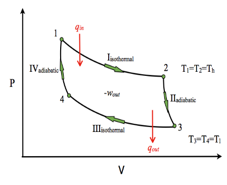

# Thermal

## Basic Concepts

Some properties, such as mass and volume, scale with the amount of material: these are called extensive varaiables

Others, such as temperature and pressure are independent of the amount of material: these are intensive variables

In a containter filled with gas, pressure, temperature, volume, mass, and density are well defined. These values that we do not need to know the history of how they were achieved in their present state are called functions of state

Not all variables are functions of state, some quantities like the amount of heat supplied to a gas or the amount of work done on the gas, depend on knowing the history of how the gas reached its present state

The pressure, temperature, and volume of a state are not independent variables, their relationship is known as an equation of state.

```math
pV = nRT = Nk_{B}T
```

Heat is thermal energy in transit - heat will flow from the hot body to the cool body until both are in equilibrium

Temperature is a measure of the internal energy of the body

> Temperature is a function of state but Heat is not

## Laws of Thermodynamics

### Zeroth Law

If two bodies $A$ and $B$ are in thermal equilibrium with each other, and a third body $C$ is in equilibrium with $A$, then $C$ is also in equilibrium with $B$

### First Law

```math
dU = \bar dQ + \bar dW
```

Where $U$ is the internal energy, $Q$ is heat supplied to the systema and $W$ is the work done on the system

Work done on an expanding gas:

```math
\bar dW = -pdV
```

$dU$ is an exact differential meaning that it is path independent, whereas, $\bar dQ$ and $\bar dW$ are inexact differentials where the definite integrals depend on the paths taken between the limits.

> Functions of state have exact integrals

### Heat Capacity

The heat capacity of a system is defined as the amount of heat that must be supplied to raise its temperature by 1K

```math
C_{V} = \left(\frac{\bar dQ}{dT}\right)_{V} \quad \text{and} \quad C_{P} = \left(\frac{\bar dQ}{dT}\right)_{p}
```

For an ideal gas we deduced that

```math
C_{p} - C_{V} = nR
```

If $F(x,y)$ is a state function, so that any changes, $dF$, depend only on changes in $dx$, $dy$ but not the path taken in changing the values of $x$ and $y$ then:

```math
dF = \left(\frac{\partial F}{dx}\right)_{y} dx + \left(\frac{\partial F}{dy}\right)_{x} dy
```

Then $p(V,T)$ gives:

```math
dp = \left(\frac{\partial p}{dV}\right)_{T} dV + \left(\frac{\partial p}{dT}\right)_{V} dT
```

#### Proof 1

Starting from First law and work done

```math
dU = \bar dQ - pdV \qquad \rightarrow \qquad \bar dQ = dU + pdV
```

Divide through by $dT$

```math
\frac{\bar dQ}{dT} = \frac{dU}{dT} + p\frac{dV}{dT}
```

$U$ is a state function so:

```math
dU = \left(\frac{\partial U}{\partial T}\right)_{V}dT + \left(\frac{\partial U}{\partial V}\right)_{T}dV
```

Divide again:

```math
\frac{dU}{dT} = \left(\frac{\partial U}{\partial T}\right)_{V} + \left(\frac{\partial U}{\partial V}\right)_{T} \frac{dV}{dT}
```

Sub in:

```math
\frac{\bar dQ}{dT} = \left(\frac{\partial U}{\partial T}\right)_{V} + \left(\frac{\partial U}{\partial V}\right)_{T} \frac{dV}{dT} + p\frac{dV}{dT}
```

```math
\frac{\bar dQ}{dT} = \left(\frac{\partial U}{\partial T}\right)_{V} + \left[ \left(\frac{\partial U}{\partial V}\right)_{T} + p \right] \frac{dV}{dT}
```

When $dV=0$:

```math
\frac{\bar dQ}{dT} \equiv C_{V} = \left(\frac{\partial U}{\partial T}\right)_{V}
```

Equality from the definition of the specific heat, corresponds to the rate of change of heat with temperature

Consider a constant pressure process with $V(p,T)$:

```math
dV = \left(\frac{dV}{dT}\right)_{p} dT + \left(\frac{dV}{dp}\right)_{T} dp
```

When $dp = 0$:

```math
dV = \left(\frac{dV}{dT}\right)_{p} dT
```

```math
\frac{dV}{dT} = \left(\frac{dV}{dT}\right)_{p}
```

Hence

```math
\frac{\bar dQ}{dT} \equiv C_{p} = \left(\frac{\partial U}{\partial T}\right)_{V}+ \left[ \left(\frac{\partial U}{\partial V}\right)_{T} + p \right] \left(\frac{dV}{dT}\right)_{p}
```

Comparing $C_{p}$ and $C_{V}$:

```math
C_{p} = C_{V} + \left[ \left(\frac{\partial U}{\partial V}\right)_{T} + p \right] \left(\frac{dV}{dT}\right)_{p}
```

If $pV = nRT$:

```math
\left(\frac{\partial V}{\partial T}\right)_{p} = \frac{nR}{p}
```

```math
p \left(\frac{\partial V}{\partial T}\right)_{p} = nR
```

Since the internal energy of an ideal gas only depends on $T$ and not $V$:

```math
\left(\frac{\partial U}{\partial V}\right)_{T} = 0
```

Therefore

```math
C_{P} = C_{V} + nR
```

> Let $\gamma = \frac{C_{p}}{C_{V}}$

### Principle of Equipartition of Energy

Each independent quadratic energy term contributes an amount $\frac{1}{2} k_{B}T$ to the total thermal energy

For each atom of a monotomic ideal gas:

```math
U_{atom} = \frac{1}{2}m \langle v_{x}^{2} \rangle + \frac{1}{2}m \langle v_{y}^{2} \rangle + \frac{1}{2}m \langle v_{z}^{2} \rangle = \frac{3}{2} k_{B}T
```

Hence for $N$ monatomic atoms

```math
C_{V} = \frac{3}{2}Nk_{B} \qquad \text{and} \qquad C_{p} = \frac{5}{2}Nk_{B}
```

#### Translational Kinetic Energies

```math
U_{atom} = \frac{1}{2}m \langle v_{x}^{2} \rangle + \frac{1}{2}m \langle v_{y}^{2} \rangle + \frac{1}{2}m \langle v_{z}^{2} \rangle = \frac{3}{2} k_{B}T
```

#### Rotational Kinetic Energies for Diatomic

```math
\text{Rotational Kinetic Energy} = \frac{1}{2}I\omega_{y}^{2} + \frac{1}{2}I\omega_{z}^{2}
```

#### Vibrational Kinetic Energies for Diatomic

```math
\text{Vibrational Kinetic Energy} = \frac{1}{2}k_{x}^{2} + \frac{1}{2}\mu u_{x}^{2}
```

Here $u_{x}$ is the vibrational speed of one atom relative to the other, $k$ is the spring constant of the bond and $\mu$ is the reduced mass:

```math
\frac{1}{\mu} = \frac{1}{m_{1}} + \frac{1}{m_{2}}
```

### Diatomic Ideal Gases

Total number of degrees of freedom $=7$, so you would expect molar heat capacity to be:

```math
C_{p} = \frac{7}{2}R
```

But this is only true for high temperatures at $T=2000+$ K, which is because of the spacing of quantum energy levels

### Heat Engines - Carnot Cycle

The Carnot cycle is a theoretical demonstration of maximum efficiency:



- 1-2 isothermal expansion
- 2-3 adiabatic expansion
- 3-4 isothermal compression
- 4-1 adiabatic compression

> Changes of state include
>
> - adiabatic - no heat in or out
> - isobaric - constant pressure
> - isochoric - constant volume
> - isothermal - constant temperature

#### Adiabatic Expansion

By definition, for an adiabatic expansion of gas, $Q = 0$

```math
dU = \bar dW = -pdV
```

```math
dU = \left(\frac{\partial U}{\partial T}\right)_{V}dT + \left(\frac{\partial U}{\partial V}\right)_{T}dV = -pdV
```

For an ideal gas, $U$ is a function of $T$ only

```math
\left(\frac{\partial U}{\partial V}\right)_{T} = 0
```

```math
C_{v}dT = -pdV = -\frac{nRT}{V}dV
```

Integrate

```math
C_{v}\int \frac{dT}{T} = -nR\int \frac{1}{V}dV
```

```math
C_{V}\text{ln}T = -nR \text{ln}V + \text{const.}
```

Using $nR = C_{p} - C_{V}$

```math
C_{V}\text{ln}T = -(C_{p} - C_{V}) \text{ln}V + \text{const.}
```

```math
\text{ln}T = \left(1 - \frac{C_{p}}{C_{V}}\right) \text{ln}V + \text{const.} \qquad \rightarrow \qquad \text{ln}T = (1 - \gamma) \text{ln}V + \text{const.}
```

Take the exponential from both sides and these relationships will appear:

```math
T \propto V^{1-\gamma}
```

So,

```math
TV^{\gamma-1} \propto \text{const.} \qquad \rightarrow \qquad PV^{\gamma} \propto \text{const.}
```

### Work

Work done in isothermal stage $1 \rightarrow 2$

```math
W_{12} = -nRT_{h} \int_{V_{1}}^{V_{2}} = -nRT_{h} \text{ln} \frac{V_{2}}{V_{1}} < 0
```

Work done in isothermal stage $3 \rightarrow 4$

```math
W_{34} = -nRT_{c} \int_{V_{3}}^{V_{4}} = -nRT_{c} \text{ln} \frac{V_{4}}{V_{3}} > 0
```

Work done in adiabatic stage $2 \rightarrow 3$

```math
W_{23} = \frac{p_{3}V_{3} - p_{2}V_{2}}{\gamma - 1}
```

Work done in adiabatic stage $4 \rightarrow 1$

```math
W_{23} = \frac{p_{1}V_{1} - p_{4}V_{4}}{\gamma - 1} = -W_{23}
```

In general for isothermal compression or expansion:

```math
W = -nRT \text{ln} \frac{V_{f}}{V_{i}} > 0
```

And for adiabatic compression or expansion:

```math
W_{23} = \frac{p_{f}V_{f} - p_{i}V_{i}}{\gamma - 1}
```

### Real Gases

#### Van der Waals Equation of State

```math
\left(p + \frac{an^{2}}{V^{2}}\right)(V-nb) = nRT
```

Reduces to ideal gas limit when $V >> nb, n\sqrt{a}$. Terms $a$ and $b$ are characteristics of the particular gas that is determined by the experiment

Rewrite as:

```math
p = \frac{nRT}{V - nb} - \frac{an^{2}}{V^{2}} \equiv \frac{Nk_{B}T}{V-Nb'} - \frac{a'N^{2}}{V^{2}}
```

Where $n$ is the number of moles of atoms/ molecules and $N$ is the number of atoms/ molecules. If $n/N = N_{A}$ then:

```math
a' = \frac{a}{N_{A}^{2}} \qquad \text{and} \qquad b' = \frac{b}{N_{A}}
```

Hence

```math
p = \frac{Nk_{B}T}{V-Nb'} - a' \left(\frac{N}{V}\right)^{2}
```

The first term tells us that the pressure becomes infinite as $V \rightarrow Nb'$, when it reaches that, we cannot compress the gas any further.

Consider a lattice gas, where each lattice site can be occupied by at most one gas molecule. Each lattice site, assuming a cubic lattice, has 6 nearest neighbours

```math
P(\text{neighbour occupied}) = \frac{\text{no. of lattice sites occupied}}{\text{total number of lattice sites}}
```

```math
P(\text{neighbour occupied}) = \frac{Nb'}{V}
```

Therefore the average number of nearest neighbours is:

```math
\frac{6Nb'}{V}
```

The energy of interaction for a molecule at the central lattice site is the energy per pair mulitplied by the number of pairs

```math
= -\frac{6\beta Nb'}{V}
```

Minus sign for an attractive interaction, divide by two to avoid double counting interactions

```math
\text{total interaction energy} = \frac{6 \beta b'}{2} \frac{N^{2}}{V} = -\frac{a'N^{2}}{V}
```

```math
a' \equiv 3 \beta b'
```

### Second Law

Three equivalent statements:

- No process is possible whose sole result is the transfer of heat from a colder to a hotter body
- No process is possible whose sole reult is the complete conversion of heat into work
- No heat engine operating between two temperatures $T_{h}$ and $T_{c}$ can be more efficient than a Carnot engine

Clausius' Theorem, for a reversible closed cycle:

```math
\oint \frac{dQ}{T} = 0
```

Clausius' inequality, for any cycle:

```math
\oint \frac{dQ}{T} \leq 0
```

#### Proof 2

For an adiabatic path like on the Carnot cycle, $dQ = 0$ so:

```math
\int_{2}^{3} \frac{dQ}{T} = \int_{4}^{1} \frac{dQ}{T} = 0
```

Along the isotherms, $dU=0$ and $dW = -pdV$

```math
\frac{dQ}{T} = \frac{nR}{V}dV
```

So that

```math
\int_{1}^{2} \frac{dQ}{T} = nR \int_{V_{1}}^{V_{2}} \frac{1}{V} dV = nR \text{ln}\frac{V_{2}}{V_{1}}
```

```math
\int_{3}^{4} \frac{dQ}{T} = nR \int_{V_{3}}^{V_{4}} \frac{1}{V} dV = nR \text{ln}\frac{V_{4}}{V_{3}}
```

We see that:

```math
4 \rightarrow 1: T_{1}V_{1}^{\gamma -1} = T_{4}V_{4}^{\gamma -1}\implies \frac{V_{4}}{V_{1}} = \left(\frac{T_{1}}{T_{4}}\right)^{\frac{1}{\gamma-1}}
```

```math
2 \rightarrow 3: T_{2}V_{2}^{\gamma -1} = T_{3}V_{3}^{\gamma -1}\implies \frac{V_{3}}{V_{2}} = \left(\frac{T_{2}}{T_{3}}\right)^{\frac{1}{\gamma-1}}
```

We know that $T_{1} = T_{2}$ and $T_{3} = T_{4}$

```math
\frac{T_{2}}{T_{3}} = \frac{T_{1}}{T_{4}}
```

```math
\frac{V_{4}}{V_{1}} = \frac{V_{3}}{V_{2}} \implies \frac{V_{2}}{V_{1}} = \frac{V_{3}}{V_{4}}
```

```math
nR \text{ln} \left(\frac{V_{2}}{V_{1}}\right) = nR \text{ln} \left(\frac{V_{3}}{V_{4}}\right) = -nR \text{ln} \left(\frac{V_{4}}{V_{3}}\right)
```

So

```math
\int_{1}^{2} \frac{dQ}{T} + \int_{3}^{2} \frac{dQ}{T} + \int_{4}^{3} \frac{dQ}{T} + \int_{1}^{4} \frac{dQ}{T} = 0
```

### Entropy

Entropy is defined as:

```math
dS = \frac{\bar dQ_{rev}}{T}
```

Entropy is a function of state, it is an intrinsic property of a system, Entropy changes around a closed reversible cycle $=0$

### Proof 3

Going from point $A$ to $B$ via two different paths representing reversible processes:

```math
\left(\int_{A}^{B} \frac{dQ_{rev}}{T}\right)_{path 1} + \left(\int_{B}^{A} \frac{dQ_{rev}}{T}\right)_{path 2} = 0
```

From Clausius' theorem, rewrite the sign

```math
\left(\int_{A}^{B} \frac{dQ_{rev}}{T}\right)_{path 1} - \left(\int_{B}^{A} \frac{dQ_{rev}}{T}\right)_{path 2} = 0
```

```math
\left(\int_{A}^{B} \frac{dQ_{rev}}{T}\right)_{path 1} = \left(\int_{B}^{A} \frac{dQ_{rev}}{T}\right)_{path 2} = 0
```

Therefore:

```math
\Delta S = \int \frac{dQ_{rev}}{T}
```

### Changes Along Adiabatic and Isothermal Paths

For an isothermal change of state, Q is the heat transferred into the system along the path:

```math
\Delta S = \int \frac{Q}{T}
```

If the system discards heat, $Q<0$

During the freezing of a solid, at constant temperature, the entropy of the solid decreases. Heat is taken from the system and $dQ<0$. Since $T$ is constant, $dS<0$

### Irreversible processes

By Clausius' equality

```math
\oint_{cycle} \frac{dQ}{T} \leq 0
```

```math
\left(\int_{A}^{B} \frac{dQ}{T}\right)_{irreversible} + \int_{B}^{A} \frac{dQ_{rev}}{T} \leq 0
```

Exhange limits (change sign):

```math
\left(\int_{A}^{B} \frac{dQ}{T}\right)_{irreversible} - \int_{A}^{B} \frac{dQ_{rev}}{T} \leq 0
```

```math
\left(\int_{A}^{B} \frac{dQ}{T}\right)_{irreversible} \leq \int_{A}^{B} \frac{dQ_{rev}}{T}
```

We can make $A$ as close to $B$ as we like, so in general

```math
dS = \frac{\bar dQ_{rev}}{T} \geq \frac{\bar dQ}{T}
```

If this is true for a thermally isolated system, $dS\geq 0$. The Universe is the ultimate thermally isolated system, and we derived $dS\geq 0$ from the second law.

> Second Law: A process cannot occur if it would result in a decrease in the total entropy of the Universe

### Local and Global Changes in Entropy

The second law does not forbid local decreases in entropy of a system that is not isolated. Only the entropy of the Universe must not decrease

```math
\Delta S (\text{Universe}) = \Delta S (\text{System}) + \Delta S (\text{Surroundings}) \geq 0
```

### Calculating Entropy in Irreversible Processes

For an irreversible process, all we know is that over the irreversible path $dS \geq \bar dQ/ T$. Because Entropy is a function of statef, if we can find a reversible path between initial and final states, we can calculate the change in entropy of the system using the path

> Does not include calculating the entropy of the Universe

### Entropy and the First Law

From the first law:

```math
dU = dQ + dW
```

For reversible processes:

```math
dW = -pdV \qquad dQ = TdS
```

```math
dU = TdS - pdV
```

Since $U$ is a function of state:

```math
dU = \left(\frac{\partial U}{\partial S}\right)_{V} dS + \left(\frac{\partial U}{\partial V}\right)_{T} dV
```

Hence

```math
T = \left(\frac{\partial U}{\partial S}\right)_{V} \qquad p = \left(\frac{\partial U}{\partial V}\right)_{T}
```

This is called the central equation of thermodynamics or the thermodynamic identity.

This leads to two important relations

```math
T = \left(\frac{\partial U}{\partial S}\right)_{V} \qquad p = -\left(\frac{\partial U}{\partial V}\right)_{S}
```
